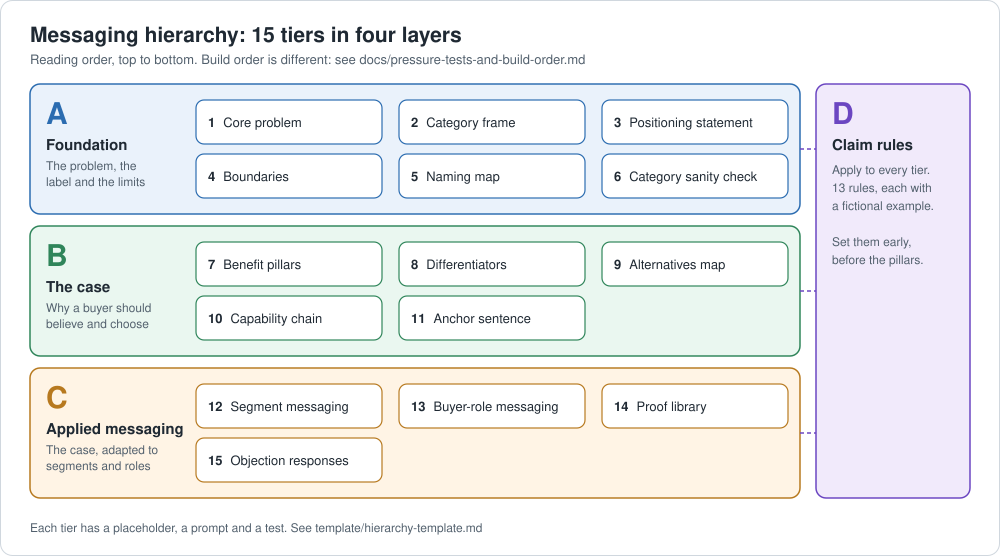

# Messaging hierarchy template

A fill-in framework for building a messaging hierarchy that marketing, sales, product and leadership can all use without contradicting each other.

15 tiers in four layers. 13 claim rules. A fully worked example. A build order.

## Who it is for

Product marketers, marketing leads and founders who need one source for what the company says, so that reps, writers and product all say the same thing.

## How to use it

1. Read the [build guide](docs/pressure-tests-and-build-order.md). The order you build in is not the order you read in.
2. Copy the [template](template/hierarchy-template.md) and fill in each placeholder. Grade each tier with the test line under it.
3. Set the [claim rules](template/claim-rules.md) before you write benefits, and check every tier against them.
4. Pressure-test each tier with the table in the build guide.

## See it filled in

The [worked example](examples/budgeting-app-worked-example.md) fills in all 15 tiers for an invented budgeting app. Two tiers from it:

**Tier 1: Core problem**
> Renters with little slack in their budget cannot see that their spending has drifted until the week rent is due, which leads to overdraft fees, late rent or borrowing.

**Tier 11: Anchor sentence**
> We flag spending drift early, so renters can adjust while there is still time, which helps them avoid a short rent week.

The example leaves numbers in brackets on purpose. It also shows a differentiator being tested and cut, and a pillar list kept at two because a third would be padding.

## What is in this repo

| Path | What it is |
|---|---|
| [template/hierarchy-template.md](template/hierarchy-template.md) | The 15 tiers: a placeholder, a prompt and a test for each |
| [template/claim-rules.md](template/claim-rules.md) | 13 claim rules, each with a fictional example |
| [docs/pressure-tests-and-build-order.md](docs/pressure-tests-and-build-order.md) | How to test each tier, the order to build in, and what to do when tiers conflict |
| [examples/budgeting-app-worked-example.md](examples/budgeting-app-worked-example.md) | The full template filled in for an invented budgeting app |
| [assets/tier-map.svg](assets/tier-map.svg) | The diagram above |

## About

I'm Alecia O'Brien, a marketing leader with more than 20 years in strategy, positioning and go-to-market. This framework comes from building messaging hierarchies in B2B technology. Every example here is invented.

## License

Creative Commons Attribution 4.0 International (CC BY 4.0). Reuse it, adapt it, and credit Alecia O'Brien. See [LICENSE](LICENSE).
